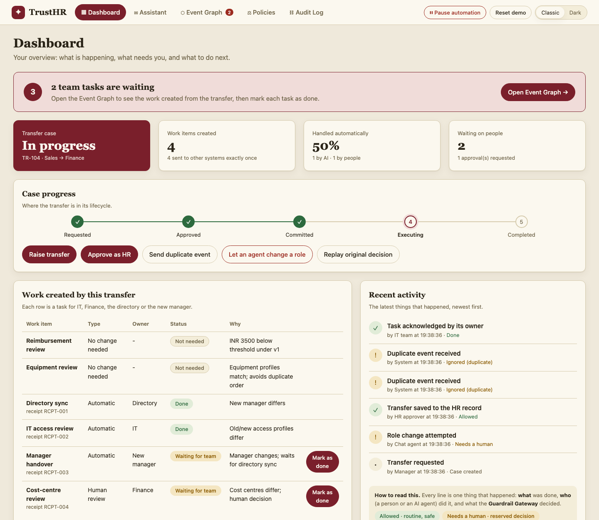
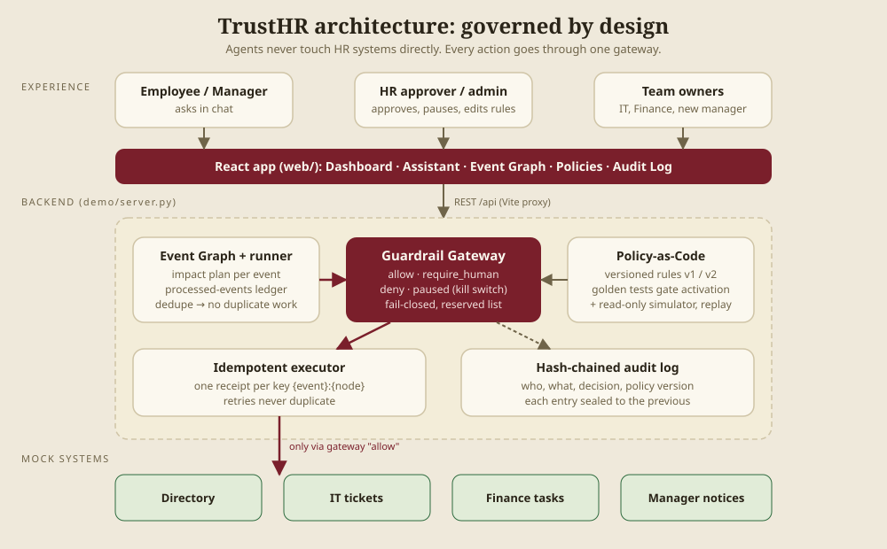
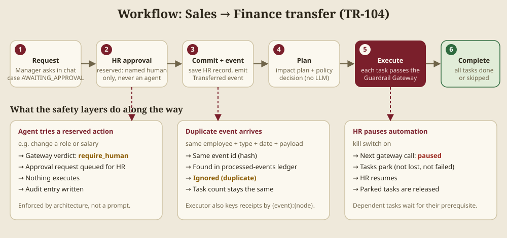
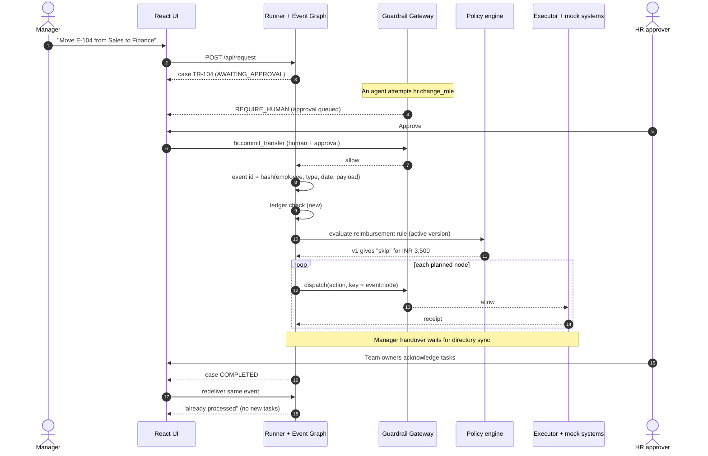
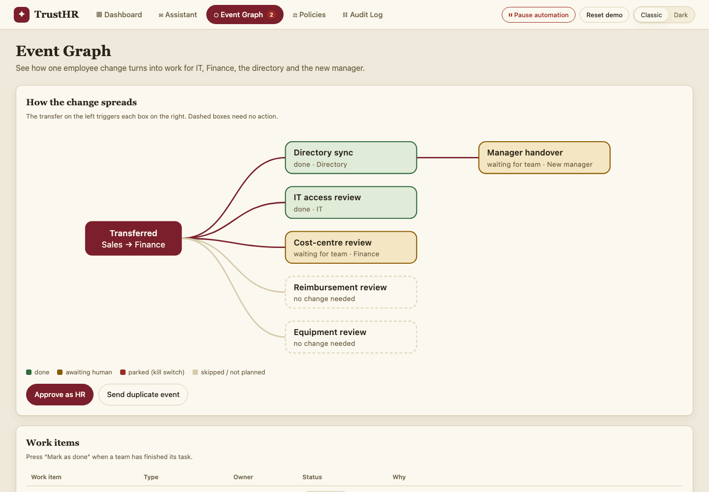
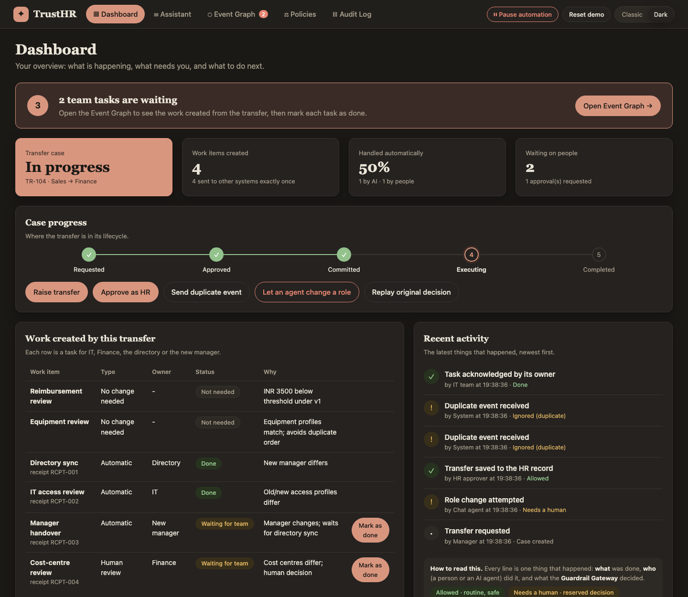
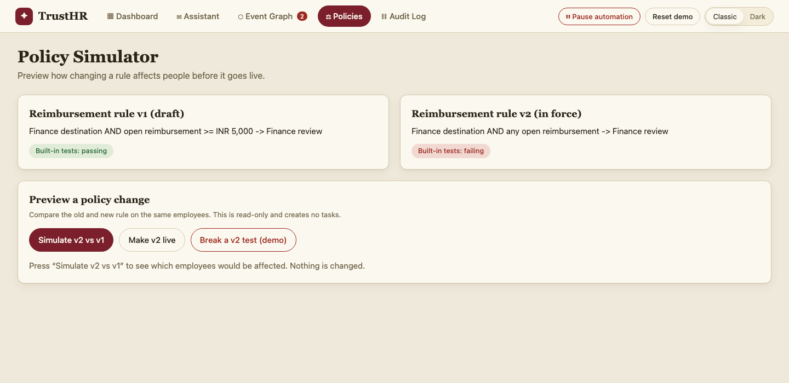
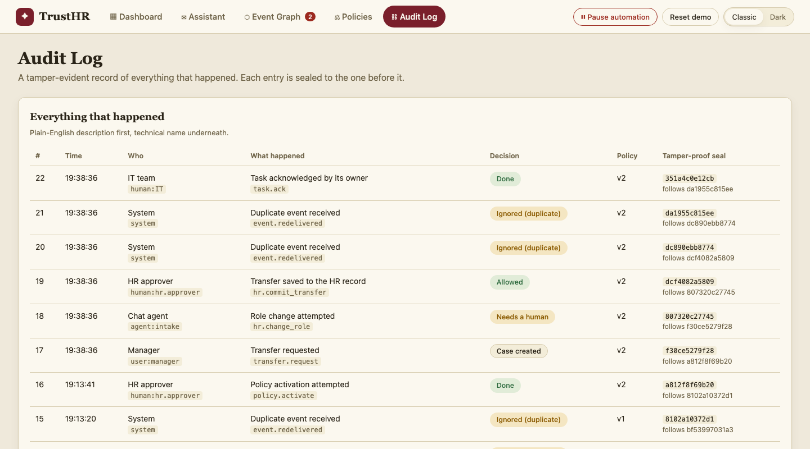
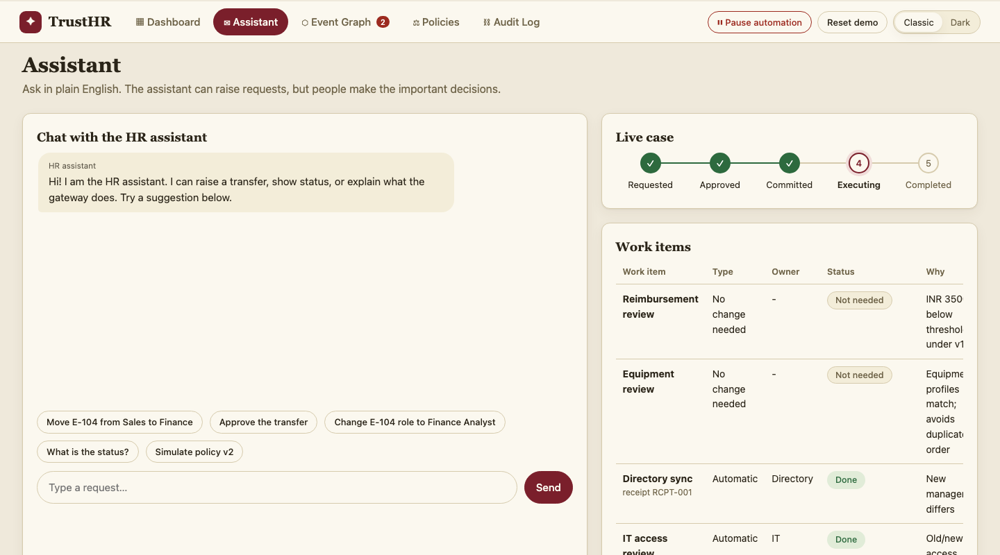

# TrustHR: governed AI for HR lifecycle changes

[](https://trusthrtbo-dhgkf771t-shivansh-mandolias-projects.vercel.app/)
[](https://trusthr-tbo-1.onrender.com)

> **Architecture, not prompts, decides what agents may do.**
> A complete, runnable AI-native HR platform built for the TBO Voyage Hacks "AI-Native HR Services" challenge. It follows one employee transfer (**Sales → Finance**) from request to completion, and shows how an AI-driven workflow can stay safe, auditable and easy to change.

🚀 **[Open Live Demo →](https://trusthrtbo-dhgkf771t-shivansh-mandolias-projects.vercel.app/)**



---

## Table of contents
1. [The problem](#the-problem)
2. [The four innovations](#the-four-innovations)
3. [Architecture](#architecture)
4. [Workflow: the TR-104 transfer](#workflow-the-tr-104-transfer)
5. [Screens](#screens)
6. [Quick start](#quick-start)
7. [Guided demo script](#guided-demo-script)
8. [How each innovation works in the code](#how-each-innovation-works-in-the-code)
9. [API reference](#api-reference)
10. [Project structure](#project-structure)

---

## The problem

When an employee moves teams, HR typically emails IT, Admin and Finance, then chases each one. Handing this to AI agents is attractive, but it raises hard questions:

- What stops an agent from doing something it must not, such as changing a salary or accepting a resignation?
- What happens when the same event arrives twice, or an API times out and is retried?
- What happens to in-flight work when HR changes a policy?
- Can an auditor see exactly who decided what, under which rule version?

TrustHR answers each of these with an architectural mechanism, not a prompt.

## The four innovations

| # | Innovation | What it guarantees |
|---|---|---|
| 1 | **Guardrail Gateway** | The single path between agents and HR systems. Reserved actions (role, salary, grade changes, transfer approval…) are *unreachable* by agents and always need a named human. Fail-closed, with a kill switch. |
| 2 | **Policy-as-Code with golden tests** | Rules are versioned, deterministic and tested. No LLM computes a result. Activation is blocked if a golden test fails. Any past decision can be replayed under the version in force at the time. |
| 3 | **Policy Change Impact Simulator** | Before a rule goes live, compare old and new on the same employee snapshot. It is read-only: a dry run creates zero tasks. |
| 4 | **Employee Lifecycle Event Graph** | One committed change (`Transferred`) becomes an impact plan: what to initiate, what needs human review, what to leave alone, each with a reason. A processed-events ledger means the same event never creates duplicate work. |

They form one closed loop:

| Layer | Question it answers |
|---|---|
| Event Graph | *What must happen because of this event?* |
| Guardrail Gateway | *Is this agent allowed to do this, right now?* |
| Policy-as-Code | *What does the approved policy say?* |
| Impact Simulator | *What will change if we edit the rule?* |

## Architecture



**Layers**

- **Experience (`web/`)**: a React app for employees and managers (chat), HR approvers (approve, pause, edit rules) and team owners (acknowledge tasks).
- **Backend (`demo/server.py`)**: a dependency-free Python service holding the event graph, policy engine, gateway, executor and audit log.
- **Mock systems**: directory, IT tickets, Finance tasks and manager notices, simulated in-process. They are only reachable through the gateway's `allow` verdict.

**Gateway verdicts**

| Verdict | Meaning | Example |
|---|---|---|
| `allow` | Routine action, dispatched with a stable idempotency key | Update manager in the directory |
| `require_human` | Reserved action; queued for a named approver | Agent tries `hr.change_role` |
| `deny` | Unknown action, rejected (fail-closed) | Any action not in the catalog |
| `paused` | Kill switch is on; work parks instead of failing | HR pressed "Pause automation" |

## Workflow: the TR-104 transfer



The same flow as a sequence:



**Impact plan for TR-104 under policy v1**

| Work item | Class | Result |
|---|---|---|
| Directory sync | Automatic | Done, receipt issued |
| IT access review | Automatic, then team acknowledgement | Ticket opened |
| Manager handover | Automatic, **waits for directory sync** | New manager notified |
| Cost-centre review | Human review | Finance decides |
| Reimbursement review | Policy decision | **Skipped**: INR 3,500 is below the INR 5,000 threshold in v1 |
| Equipment review | Leave unchanged | **Skipped**: equipment profiles match |

Under policy **v2** (any open reimbursement triggers review), the reimbursement review is created as well.

## Screens

| | |
|---|---|
| **Event Graph**: how one change fans out into work | **Dark theme**: warm and low-glare |
|  |  |
| **Policies**: compare rule versions before they go live | **Audit Log**: every entry sealed to the previous one |
|  |  |

**Assistant**: ask in plain English ("Move E-104 from Sales to Finance", "Approve the transfer", "What is the status?").



The UI has a Classic (parchment and burgundy) and a Dark theme, a "what to do next" guide on the dashboard, and plain-English labels for every technical event.

## Quick start

**Requirements:** Python 3.9+ and Node 18+. The backend uses only the Python standard library.

```bash
# 1. Backend (port 8000)
cd demo
python3 server.py

# 2. React app (port 5173), in a second terminal
cd web
npm install
npm run dev
```

Open **http://localhost:5173**.

`demo/index.html` is a simpler single-file UI, also served by the backend at http://localhost:8000 if you do not want to run the React app.

Deep links: `http://localhost:5173/#graph` opens a tab directly (`dashboard`, `chat`, `graph`, `policy`, `audit`). Add `?theme=dark` to pick the theme.

## Guided demo script

About three minutes. The dashboard banner tells you the next step at each point.

1. **Raise transfer**: a manager asks to move E-104. Case `TR-104` is `AWAITING_APPROVAL`.
2. **Let an agent change a role**: the gateway answers **Needs a human** and an approval is queued. Nothing is executed.
3. **Approve as HR**: the transfer is committed and the impact plan appears: four tasks run, two are skipped with reasons.
4. **Send duplicate event**: shown as **Ignored (duplicate)**. The task and receipt counts do not change.
5. **Pause automation**, then trigger work again: tasks park in an "On hold" state. **Resume** releases them.
6. **Mark tasks as done** (IT, manager, Finance): the case reaches **Completed**.
7. **Policies → Simulate v2 vs v1**: Finance reviews rise from **1 to 3**, with **0** changes made by the preview.
8. **Make v2 live**, then **Replay original decision**: the TR-104 decision still replays as `skip` under its original v1.
9. **Break a v2 test (demo)**, then **Make v2 live**: activation is **blocked** because a golden test fails.

Check **Audit Log** at any time. It records every step, sealed with a hash chain.

## How each innovation works in the code

All backend logic lives in [`demo/server.py`](demo/server.py).

| Innovation | Where | Idea |
|---|---|---|
| Guardrail Gateway | `CATALOG`, `gateway()`, `dispatch()` | Unknown action means `deny`. Pause flag means `paused`. A reserved action without a human actor plus approval means `require_human`. Otherwise `allow`. Every call is audited. |
| Idempotent executor | `dispatch()` | Receipts are keyed by `{event_id}:{node}`, so a retry returns the existing receipt instead of creating another. |
| Policy-as-Code | `POLICIES`, `evaluate()`, `GOLDEN`, `run_golden()` | A deterministic function of the policy version and the facts. Missing data returns `exception`, which goes to a human. |
| Simulator | `/api/simulate` | Evaluates v1 and v2 over the same cohort and reports the diff. It records the number of writes it made, which is zero. |
| Activation gate | `/api/activate` | Runs the golden tests for the candidate version and refuses to activate on failure. |
| Replay | `S["decisions"]`, `/api/replay` | Each decision stores the policy version and facts. Replay re-evaluates with the stored version. |
| Event Graph | `event_id()`, `plan_and_run()`, `advance()` | The event id is a hash of employee, type, date and payload. The ledger rejects repeats. Nodes with dependencies wait for their prerequisite. |
| Audit chain | `audit()` | Each entry's hash covers the previous hash, so editing history breaks the chain. |

## API reference

Base URL `https://trusthr-tbo-1.onrender.com` (or `http://localhost:8000` for local dev). `GET /api/state` returns everything the UI renders; the rest are `POST` with a JSON body.

| Endpoint | Purpose |
|---|---|
| `GET /api/state` | Case, tasks, audit log, policies, golden-test status, counters |
| `POST /api/request` | Manager raises the TR-104 transfer |
| `POST /api/agent_role_change` | Demo: an agent attempts a reserved action |
| `POST /api/approve` | Named HR approver commits the transfer and fires the event |
| `POST /api/redeliver` | Re-send the same event (duplicate suppression) |
| `POST /api/ack` `{node}` | A team owner marks their task done |
| `POST /api/pause` `{on}` | Kill switch on or off |
| `POST /api/simulate` | Read-only v1 vs v2 comparison over the cohort |
| `POST /api/activate` `{version}` | Make a policy version live, gated by golden tests |
| `POST /api/replay` | Re-run the original decision under its original version |
| `POST /api/break_policy` | Demo: edit v2 so a golden test fails |
| `POST /api/reset` | Restore the seeded demo state |

## Project structure

```
.
├── README.md
├── demo/
│   ├── server.py                 # backend: gateway, policies, event graph, executor, audit
│   └── index.html                # simple single-file UI (no build step)
├── web/                          # React + Vite app
│   ├── src/App.jsx               # layout, navigation, state, guided next-step banner
│   ├── src/components.jsx        # tiles, stepper, task table, activity feed, audit table
│   ├── src/Graph.jsx             # SVG event graph, colour-coded by live status
│   ├── src/Chat.jsx              # assistant panel
│   ├── src/labels.js             # plain-English names for technical codes
│   └── src/styles.css            # Classic and Dark themes
├── docs/
│   ├── architecture.svg
│   ├── workflow.svg
│   └── screenshots/
├── HR_Lifecycle_Requirements.pdf       # buildable spec (FR-01 to FR-09, acceptance checks)
└── TrustHR_Innovation_Strategy.pdf     # strategy: four innovations, scope, cost, risks
```

The two PDFs are the source documents this project implements. The requirements document narrows the strategy to one journey, the transfer.

## Project status

Complete for the Sales → Finance transfer journey. Everything below is built and working end to end:

- [x] Transfer intake, named HR approval and event commit
- [x] Guardrail Gateway with four verdicts, a reserved-action list and a kill switch
- [x] Idempotent executor: one receipt per action, however many retries
- [x] Lifecycle Event Graph with dependency ordering and duplicate-event suppression
- [x] Versioned policies (v1 and v2) with golden tests that gate activation
- [x] Read-only Policy Impact Simulator and decision replay under the original version
- [x] Hash-chained audit log with plain-English activity feed
- [x] Chat assistant, dashboard with guided next steps, Event Graph view
- [x] Classic and Dark themes, and a responsive full-width layout
